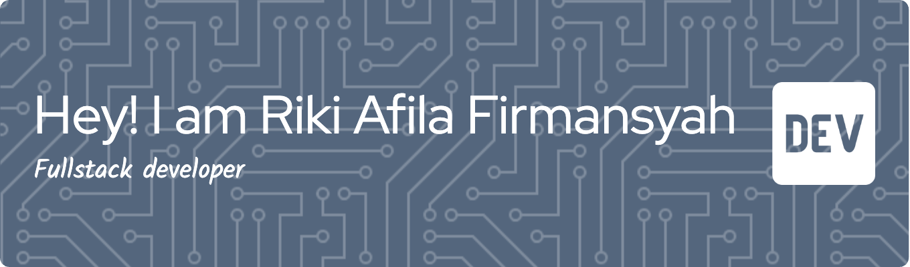
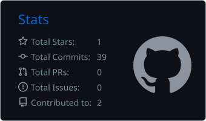
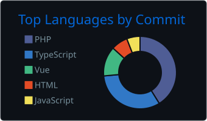

  

<h1 align="center">Hi, I'm Riki Afila Firmansyah 👋</h1>

  <b>Fullstack Developer</b> · building web applications end-to-end with <b>Vue / Nuxt</b>, <b>React / Next.js</b>, <b>NestJS</b>, and <b>Laravel</b>

  
  
  
  

---

## 🙋‍♂️ About Me

- 💼 Fullstack Developer at **WZ Technology**
- 📍 Based in **Bandung, Indonesia** (UTC+7 / WIB), working remotely
- 🧩 I take features from database design and REST APIs through to responsive, production-ready UIs
- 🛠️ Day to day I work with **TypeScript**, **Vue/Nuxt**, **NestJS**, and **Laravel**
- 🌱 Currently sharpening: scalable backend architecture, testing, and clean code practices
- 📫 **Available for remote freelance** outside office hours (weekdays after 18:00 WIB & weekends): [rikiafilaf.work@gmail.com](mailto:rikiafilaf.work@gmail.com)

---

## 🧰 Tech Stack

**Languages**

**Frontend**

**Backend**

**Databases & Caching**

---

## 🚀 Featured Projects

| Project | Description | Stack |
|---|---|---|
| [**muhasabah-daily**](https://github.com/rikiafilafwork/muhasabah-daily) | Daily self-reflection (muhasabah) app | TypeScript |
| [**vue3-todo-app**](https://github.com/rikiafilafwork/vue3-todo-app) | Todo app built with the Vue 3 Composition API | Vue 3 |
| [**pomodoro-timer**](https://github.com/rikiafilafwork/pomodoro-timer) | Pomodoro focus timer | JavaScript |

> 🔒 Most of my professional work (fullstack web apps, event platforms, admin dashboards with role management) lives in private repositories. Happy to walk through it on a call.

---

## 📊 GitHub Stats

  
  

  

---

  <b>Let's build something great together.</b> 
  🌐 <a href="https://rikiafilafwork.github.io">rikiafilafwork.github.io</a> · 📩 <a href="mailto:rikiafilaf.work@gmail.com">rikiafilaf.work@gmail.com</a> · 💼 <a href="https://linkedin.com/in/riki-afila-f-7068631a9">LinkedIn</a>

